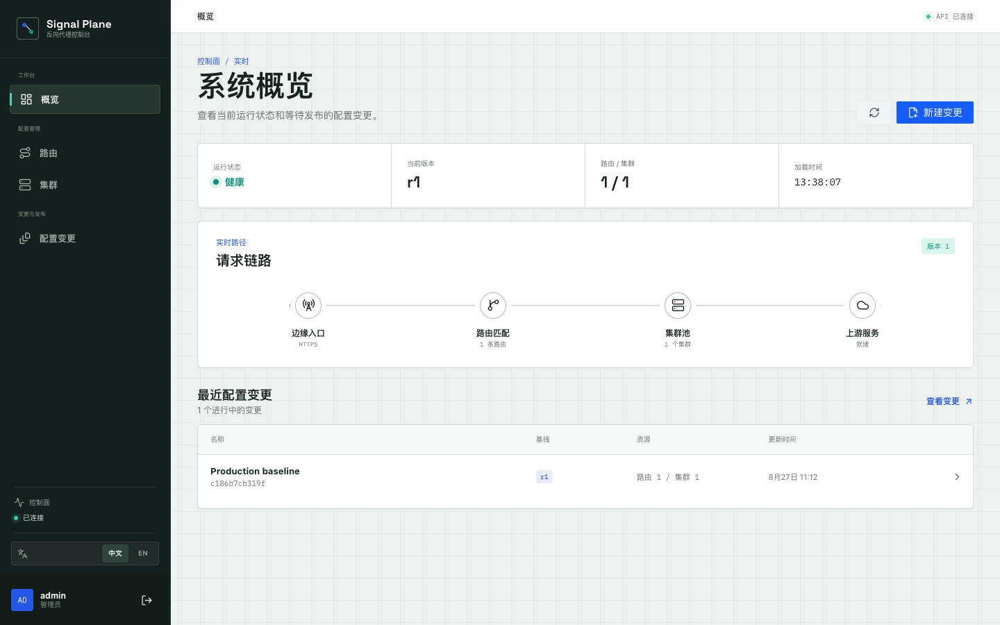
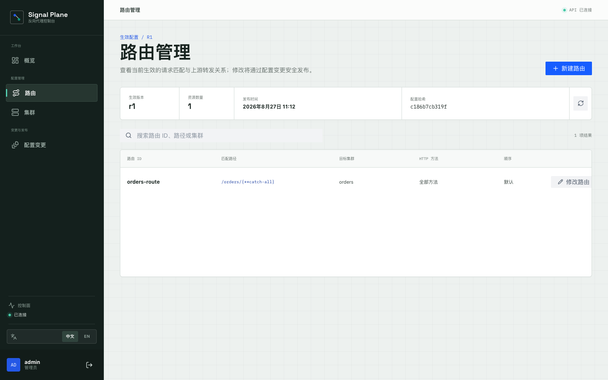
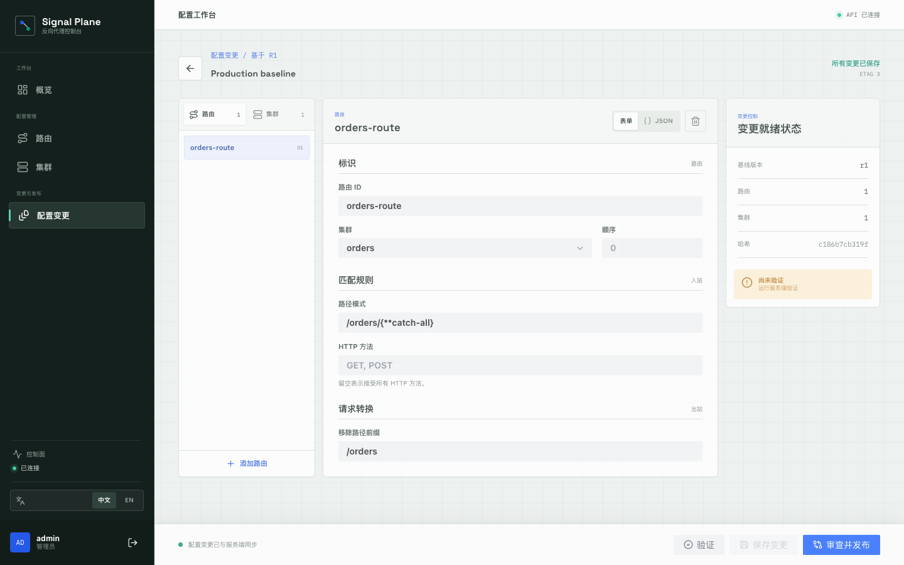

# ReverseProxy.Store

English | [简体中文](README_CN.md)

[](https://www.nuget.org/packages/ReverseProxy.Store)
[](LICENSE)

ReverseProxy.Store 3.0 is a revision-based control plane for YARP. It stores canonical proxy configuration in PostgreSQL, publishes immutable revisions through a secured HTTP API, and distributes revision notifications to runtime nodes through Redis.

> 3.0 is currently `preview.1` and intentionally replaces the mutable 2.x entity/CRUD model.

## Components

- `ReverseProxy.Store`: canonical configuration documents, validation/diff logic, and the revision-aware YARP provider.
- `ReverseProxy.Store.EFCore`: PostgreSQL-compatible revision and control-plane persistence models.
- `ReverseProxy.Store.Distributed`: typed Redis revision publisher/subscriber.
- `ReverseProxy.WebApi`: Identity cookie authentication, CSRF protection, configuration change APIs, audit records, health checks, and the YARP runtime.
- `ReverseProxy.Dashboard`: production SPA host and same-origin API proxy.
- `ReverseProxy.Dashboard/ClientApp`: Vue 3, TypeScript, Pinia, Vite, and Arco Design control console.

## Dashboard

Signal Plane organizes the control plane around operator tasks rather than storage concepts:

- **Workspace / Overview** shows runtime health, the active revision, request flow, and changes in progress.
- **Configuration / Routes and Clusters** exposes the active resource catalog and its relationships. Active resources are read-only; creating or editing one starts a safe configuration change.
- **Changes & delivery / Configuration changes** provides form and JSON editing, server validation, diff review, optimistic concurrency, and publishing.
- **Changes & delivery / Revision history** provides immutable release inspection and forward-only restore with active-revision concurrency protection.

The responsive interface defaults to Simplified Chinese and can be switched to English at any time.

### Runtime overview



### Route management



### Configuration change studio



## Configuration Workflow

1. Create a configuration change from the current active revision.
2. Add or update routes and clusters with the form editor or canonical JSON document.
3. Run server-side validation and inspect the diff against the base revision.
4. Publish with the current `ETag`; stale edits are rejected instead of overwriting newer work.
5. Runtime nodes reload the new immutable revision from PostgreSQL after the local publish signal or a Redis notification.

The primary HTTP surfaces are:

| Area | Endpoints |
| --- | --- |
| Authentication | `/api/v1/auth/antiforgery`, `/api/v1/auth/login`, `/api/v1/auth/me`, `/api/v1/auth/logout` |
| Active runtime | `/api/v1/runtime/status`, `/api/v1/runtime/configuration` |
| Configuration changes | `/api/v1/drafts`, `/api/v1/drafts/{id}/validate`, `/api/v1/drafts/{id}/diff`, `/api/v1/drafts/{id}/publish` |
| Revision history | `/api/v1/revisions`, `/api/v1/revisions/{id}`, `/api/v1/revisions/{id}/rollback` |
| Configuration operations | `/api/v1/operations/{id}` |

## Publish Model

Publishing runs in a serializable PostgreSQL transaction. It writes the immutable revision, moves the active revision pointer, records the operation and audit entry, and appends a typed outbox event.

Rollback is forward-only: restoring a historical document creates a new, higher revision instead of moving the active pointer backward. The caller supplies the expected active revision ID, so a concurrent publish is rejected rather than overwritten. A recovery worker completes operations left in `Applying` after a process interruption.

The outbox worker claims rows with `FOR UPDATE SKIP LOCKED`, publishes `proxy-config.published` events, and acknowledges successful delivery. Redis is only a low-latency hint: every subscriber reloads and validates the authoritative active revision from PostgreSQL. Duplicate and out-of-order events are safe, and periodic reconciliation covers notifications missed during a Redis outage.

## Requirements

- .NET SDK 10.0
- Node.js 22 and npm
- Docker Desktop, or externally managed PostgreSQL 17 and Redis 7

## Local Development

Start PostgreSQL and Redis:

```bash
docker compose up -d
```

Trust the ASP.NET Core development certificate once, then start the API. The bootstrap credentials are used only when the user store is empty.

```bash
dotnet dev-certs https --trust
ASPNETCORE_ENVIRONMENT=Development \
BootstrapAdmin__UserName=admin \
BootstrapAdmin__Password='replace-with-a-development-password' \
dotnet run --project ReverseProxy.WebApi
```

Start the Vite development server in another terminal:

```bash
npm --prefix ReverseProxy.Dashboard/ClientApp ci
npm --prefix ReverseProxy.Dashboard/ClientApp run dev
```

Open `http://localhost:5173`. Vite proxies `/api` and `/health` to `https://localhost:5201`.

To exercise the production-style SPA host instead:

```bash
npm --prefix ReverseProxy.Dashboard/ClientApp run build
dotnet run --project ReverseProxy.Dashboard
```

Open `http://localhost:5232`.

## Configuration

Use environment variables or a secret provider outside development. Important settings are:

```text
ConnectionStrings__Default
ConnectionStrings__Redis
Database__ApplyMigrationsOnStartup
BootstrapAdmin__UserName
BootstrapAdmin__Password
Redis__ChannelName
Redis__SubscriptionRetryDelay
Redis__ReconciliationInterval
Outbox__BatchSize
Outbox__PollInterval
Outbox__FailureDelay
Operations__BatchSize
Operations__PollInterval
AllowedHosts
```

`ConnectionStrings__Redis` is optional for a single-node runtime. When omitted, local publish/reload still works and outbox records remain durable; enabling Redis later drains pending records. Configure Redis on every node for multi-node distribution.

Production should apply migrations as a deployment step and keep `Database__ApplyMigrationsOnStartup=false`:

```bash
dotnet tool restore
ConnectionStrings__Default='Host=db;Database=reverseproxy_store;Username=reverseproxy;Password=replace-me' \
  dotnet ef database update \
  --project ReverseProxy.WebApi \
  --startup-project ReverseProxy.WebApi
```

The Dashboard forwards `/api` and `/health` to the control plane. Override its production destination with:

```text
ReverseProxy__Clusters__control-plane__Destinations__api__Address
```

## Validation

```bash
dotnet restore ReverseProxy.Store.sln
dotnet build ReverseProxy.Store.sln -c Release --no-restore
dotnet test tests/ReverseProxy.Store.Tests/ReverseProxy.Store.Tests.csproj -c Release --no-restore
npm --prefix ReverseProxy.Dashboard/ClientApp ci
npm --prefix ReverseProxy.Dashboard/ClientApp run typecheck
npm --prefix ReverseProxy.Dashboard/ClientApp run build
```

Integration tests use Testcontainers and require Docker.

## AI Provider

[](https://www.orcarouter.ai/ref/ref_293cafb35044abc53d15)
